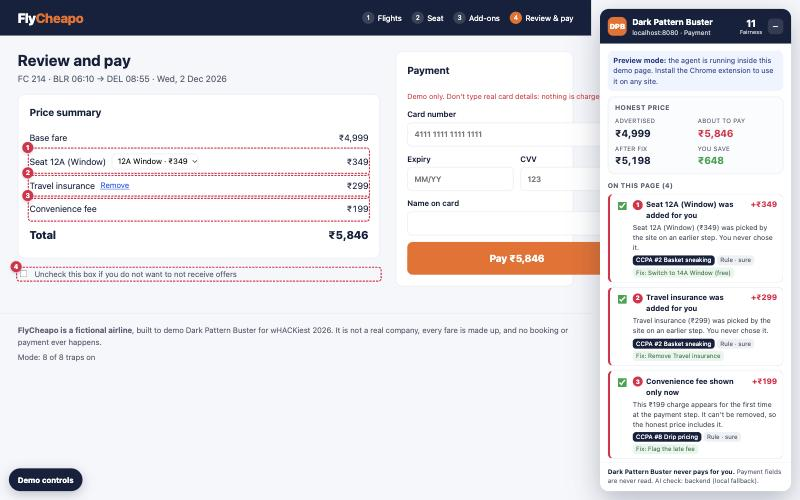
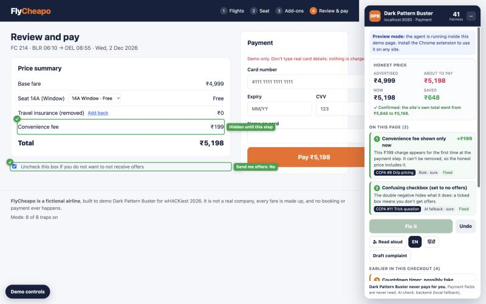

# Dark Pattern Buster

**An AI browser agent that catches checkout tricks, undoes them with your OK, and shows the honest price before you pay.**

> [!IMPORTANT]
> **Working MVP prototype.** The organisers withdrew the ideathon's No-Code Rule, so this repo now holds a basic working prototype alongside the plans: the Chrome extension agent, FlyCheapo (the fictional demo airline with 8 traps), and the AWS backend. It runs the full demo end to end on a laptop. We keep improving it until Ideation Day, and build the full product at the 24-hour offline hackathon on 1–2 December 2026. [Run it in 2 minutes ↓](#run-the-prototype)

| | |
|---|---|
| **Event** | wHACKiest 2026 · CodeRIT, Ramaiah Institute of Technology |
| **Track** | Track 2 – Beyond the Browser |
| **Team** | Dangling Pointers · RV College of Engineering, Bengaluru |
| **Stage** | Ideathon: working MVP prototype and execution plan |
| **Pitch deck** | [Open the deck](https://docs.google.com/presentation/d/1eQIBH804qREIl9Vjo78zsTjLMRGb4w_3O2SxmFx4Rso/edit?usp=sharing) |
| **Video pitch** | [Watch the pitch](https://youtu.be/MxastKMiJvo) |
| **Live demo** | [Try FlyCheapo with the agent](https://hack-abhinav.github.io/dark-pattern-buster/demo-site/?mode=traps&agent=preview) (no install; AI checks need the backend) |

---

## The problem in 30 seconds

You find a flight for **₹4,999**. At the payment page it costs **₹5,846**, and you never chose the extras.

- **8 in 10** airline passengers in India have faced dark patterns while booking or managing flights ([LocalCircles, Dec 2025](https://m-www.localcircles.com/a/press/page/airline-dark-patterns-survey): 124,000+ responses from 302 districts).
- **80%** said charges that were not shown upfront appeared at final payment "very frequently". **30%** said add-ons were slipped in without their consent "very frequently".
- India's Central Consumer Protection Authority (CCPA) banned **13 dark patterns** in 2023, and in June 2025 told every e-commerce platform to self-audit. But at the moment of payment, nobody checks the checkout for the shopper.

Full problem statement: [docs/01-problem.md](docs/01-problem.md)

## Our solution

Dark Pattern Buster is a Chrome extension that rides along at checkout. On every step it runs one loop:

**Watch → Detect → Explain → Fix → Verify**

In practice: you shop normally → the agent scans each step → it flags and explains tricks → you tap **Fix it** → the honest price is shown → you pay. The agent never pays for you.

### One booking, before and after

| Checkout line | What the site charged | Trick (CCPA dark pattern) | After "Fix it" |
|---|---|---|---|
| Base fare | ₹4,999 | – | ₹4,999 |
| Seat | ₹349: a paid seat was picked for you, though free seats exist | Basket sneaking | ₹0 (free seat) |
| Travel insurance | ₹299: the box was already ticked | Basket sneaking | ₹0 (unticked) |
| Convenience fee | ₹199: shown for the first time at payment | Drip pricing | ₹199 (kept, but shown from the start) |
| **Total** | **₹5,846** | | **₹5,198: ₹648 saved** |

On the same journey it also flags the countdown that resets and the "only 2 seats left" claim (false urgency), the guilt-trip "No" button (confirm shaming), the tiny grey skip link (interface interference) and the confusing double-negative checkbox (trick question).

The overlay's **Honest Price card** then reads: Advertised ₹4,999 · About to pay ₹5,846 · After fix ₹5,198 · **You save ₹648**.

This is the prototype running on FlyCheapo's payment page, before and after one tap on **Fix it**:

| Before: 4 tricks flagged, ₹5,846 | After: the site's own total confirms ₹5,198 |
|---|---|
|  |  |

### Key features

- **Live detection, mapped to Indian law:** every finding is tagged with one of the CCPA's 13 dark patterns.
- **Price Ledger:** tracks every rupee added between checkout steps, so late fees and sneaked extras can't hide.
- **One-tap "Fix it":** unticks add-ons, picks the free seat and declines extras, only after you tap.
- **Honest Price card:** advertised vs about-to-pay vs fixed price, checked against the site's own total.
- **Real price before you pick:** once a site's hidden fees and pre-selected extras are known (from your earlier checkout, or other users' through the backend), every result on the listing page shows its price at checkout and its honest price.
- **Voice alerts (ElevenLabs):** spoken warnings in English and Hindi for elderly and low-vision users.
- **Complaint draft:** prepares a complaint for the National Consumer Helpline (1915), with the evidence attached.
- **Never pays for you:** the agent never types payment details and never presses Pay.

## How it fits Track 2: Beyond the Browser

Track 2 asks for browser-based agents that go beyond browsing and search, and make the web smoother and more accessible.

| Track theme | Dark Pattern Buster |
|---|---|
| Browser agents | An agent in the user's own browser that watches, decides and acts at checkout |
| Web automation | Undoes tricks on the page itself: unticks boxes, picks free options, declines extras |
| Accessibility | Plain-English explanations and spoken alerts in English and Hindi |
| Finishing complicated tasks | Turns a confusing multi-step checkout into one honest number before you pay |

## How it works

**Your browser** (Chrome extension: content script, rule engine, React overlay) → **Amazon API Gateway → AWS Lambda** (FastAPI) → **Amazon Bedrock** (AI checks) · **Amazon DynamoDB** (Price Ledger, Fairness Scores) · **Amazon S3** (evidence) · **ElevenLabs** (voice)

1. **Capture:** the extension reads each checkout step: prices, checkboxes, buttons, timers and how they look. It skips payment and personal fields.
2. **Detect:** a JavaScript rule engine flags obvious traps in milliseconds: pre-ticked paid boxes, late fees, resetting timers, hidden skip links.
3. **Check:** for subtle cases such as guilt-trip wording or a confusing checkbox, a short text snippet goes to Amazon Bedrock through API Gateway and Lambda.
4. **Act:** the overlay explains each trick in plain words. You tap "Fix it" and the agent undoes the ones you approve.
5. **Verify:** the agent re-reads the site's own total, records the saving in the Price Ledger, and ElevenLabs reads out the result.

Full technical blueprint: [docs/03-architecture.md](docs/03-architecture.md) · Detection rulebook: [docs/04-dark-pattern-rules.md](docs/04-dark-pattern-rules.md)

### Tech stack

| Layer | Tools / libraries / APIs | Why we picked it |
|---|---|---|
| Frontend / agent | Chrome Extension (Manifest V3), MutationObserver, shadow-DOM overlay. The prototype is plain JavaScript with no build step; we move it to TypeScript + React on hack day | Runs inside the user's own browser, so sites can't block it as a bot |
| Detection rules | JavaScript heuristics: pre-ticked inputs, timer resets, price jumps, hidden text | Fast, free and works offline for the common traps |
| AI / ML | Claude on Amazon Bedrock (prototype default: Claude Opus 5.5, set by `BEDROCK_MODEL_ID`) | Reads button wording (and, later, screenshots) to catch guilt-trips and double negatives |
| Backend | FastAPI (Python) on AWS Lambda + API Gateway | Serverless and near-zero cost at hackathon scale |
| Database / storage | Amazon DynamoDB, Amazon S3 | Price Ledger and site Fairness Scores; evidence screenshots |
| Voice | ElevenLabs text-to-speech | Spoken warnings in English and Hindi |
| Hosting | AWS Amplify (demo site in React + Vite) | One-step deploy of the FlyCheapo demo site |
| Hardware | None | Runs on any laptop with Chrome |

## Run the prototype

You need Google Chrome and Python 3.9 or newer. Nothing to build or install for the extension or the demo site.

**1. Start the FlyCheapo demo site** (from the repo folder):

```bash
python3 -m http.server 8080
```

**2. Load the extension:** open `chrome://extensions`, turn on **Developer mode**, click **Load unpacked** and pick the `extension/` folder.

**3. Book a flight:** open <http://localhost:8080/demo-site/> and go through search → seat → add-ons → payment. The agent's panel appears on the right. Reload the search page once to catch the fake timer. On the payment page, tap **Fix it**: ₹5,846 drops to ₹5,198. Use **Demo controls** (bottom left) to switch to honest mode or turn single traps on and off.

**4. Optional: the AI backend.** Rules alone catch 6 of the 8 traps. For the other two (guilt-trip wording and the double-negative checkbox), run the backend:

```bash
cd backend && python3 -m venv .venv && .venv/bin/pip install -r requirements-dev.txt
```

```bash
cd backend && .venv/bin/uvicorn app.main:app --port 8000
```

With AWS credentials and Bedrock access it asks Claude on Amazon Bedrock; without them it uses a small local fallback and says so in the panel. Set `ELEVENLABS_API_KEY` for spoken alerts; without it the browser's own voice reads them. Deploy to AWS with `sam build && sam deploy --guided` (see [backend/template.yaml](backend/template.yaml)), then paste the API URL into the extension's popup.

**No extension?** Open <http://localhost:8080/demo-site/?agent=preview> to run the same agent inside the demo page, or use the hosted copy: <https://hack-abhinav.github.io/dark-pattern-buster/demo-site/?mode=traps&agent=preview>. The hosted copy can't reach a backend on your laptop, so the two AI-checked traps show as "couldn't check" there.

**Tests:** `cd backend && .venv/bin/python -m pytest` (8 tests).

### What the prototype does today

| Part | Status |
|---|---|
| Detection on FlyCheapo | ✅ All 8 traps flagged with their CCPA names (6 by rules, 2 by the AI check) |
| Honest mode | ✅ Zero findings on all four pages |
| Price Ledger + Honest Price card | ✅ Tracks every price line across steps; ₹5,846 → ₹5,198 |
| Real price on the flight list | ✅ After one checkout, each flight shows "At checkout ₹5,846 · Honest ₹5,198" before you pick ([screenshot](docs/images/search-forecast.jpg)) |
| Fix it + verify + undo | ✅ Uses the page's own controls, then checks the site's own total |
| Voice alerts | ✅ English and Hindi (ElevenLabs through the backend, browser voice as fallback) |
| Complaint draft + evidence | ✅ Draft text, anonymised ledger download, screenshot in the extension |
| Read-only check on any site | ✅ From the extension's popup; changes nothing |
| AWS deployment | Template ready ([backend/template.yaml](backend/template.yaml)), not yet deployed |
| Real-site testing, TypeScript + React port, Chrome side panel | Next, before and on hack day |

## Why it's new

Most tools stop at a warning. **Dark Pattern Buster acts at the moment of payment: it finds the trick, undoes it with your consent, and proves the price went down.**

India has already put real effort into spotting dark patterns. The Department of Consumer Affairs ran the [Dark Patterns Buster Hackathon (DPBH-2023)](https://news.careers360.com/iit-bhu-hosts-third-round-of-dark-patterns-buster-hackathon-500-students-participates/amp) with IIT (BHU), where 40,000+ registered students built tools to detect the 13 patterns. The government's [Jagriti app](https://pib.gov.in/PressReleasePage.aspx?PRID=2086980) lets people report a suspicious URL as a complaint to the CCPA. These tools flag or report. None of them fixes the checkout before you pay.

| Capability | Dark Pattern Buster | Ad blockers | Price-comparison sites | Research scanners | Consumer helpline |
|---|---|---|---|---|---|
| Works live at checkout | ✅ | Partly | ❌ | ❌ | ❌ |
| Finds hidden fees | ✅ | ❌ | ❌ | Partly | ❌ |
| Undoes tricks for you | ✅ | ❌ | ❌ | ❌ | ❌ |
| Maps to Indian law (CCPA) | ✅ | ❌ | ❌ | ❌ | ✅ |
| Drafts a complaint | ✅ | ❌ | ❌ | ❌ | Manual |
| Voice / accessibility | ✅ | ❌ | ❌ | ❌ | ❌ |

## Hack-day plan: the MVP in 24 hours

The prototype in this repo already covers the core of this list. On 1–2 December we harden and extend it:

- A Chrome extension with an overlay panel
- **FlyCheapo**, a clearly fictional airline site with 8 built-in traps, plus an "honest mode" with none to test for false alarms
- Rule + AI detection for 6–8 dark patterns
- The Price Ledger, fix actions and the Honest Price card
- A voice alert and a complaint draft

**Timeline:** kick-off (H0–H1) → foundations (H1–H6) → all 8 traps (H6–H12) → fix and verify (H12–H17) → harden (H17–H21) → rehearse and pitch (H21–H24). Four workstreams run in parallel: extension core, overlay and voice, cloud and AI, and FlyCheapo and demo.

**The demo counts as done when:** all 8 traps are flagged with their CCPA names; one tap takes the total from ₹5,846 to ₹5,198 and the site's own total confirms it; honest mode shows zero findings; and the agent never touches payment.

Details: [docs/05-flycheapo-demo.md](docs/05-flycheapo-demo.md) · [docs/06-hack-day-plan.md](docs/06-hack-day-plan.md)

## Impact, feasibility and business model

- **Impact:** ₹648 saved on one ₹4,999 booking, about 13% of the advertised fare. The same engine works for food delivery, e-commerce, tickets and subscriptions.
- **Feasibility:** proven Chrome extension APIs, one demo site, 6–8 patterns, and near-zero cost on AWS and ElevenLabs free tiers.
- **Business:** free for shoppers, with Pro at ₹49/month. Platforms pay for "Fair Checkout Audit" reports that support the CCPA's self-audit advisory, and a Fairness Score API.

Details: [docs/07-business-and-impact.md](docs/07-business-and-impact.md)

## What's in this repo

| Path | What's inside |
|---|---|
| [extension/](extension/) | The Chrome extension. `agent/` holds the agent: page snapshot, rule engine, Price Ledger, AI checks, Fix it, overlay |
| [demo-site/](demo-site/) | FlyCheapo, the fictional airline with 8 switchable traps and an honest mode |
| [backend/](backend/) | FastAPI for AWS Lambda: Bedrock checks, ElevenLabs voice, DynamoDB and S3, SAM template, tests |
| [docs/01-problem.md](docs/01-problem.md) | The problem, survey numbers, Indian rules and gaps in today's options |
| [docs/02-solution.md](docs/02-solution.md) | Features, user flow, overlay design and design principles |
| [docs/03-architecture.md](docs/03-architecture.md) | Components, data flow, data we store, privacy and sponsor tech |
| [docs/04-dark-pattern-rules.md](docs/04-dark-pattern-rules.md) | All 13 CCPA dark patterns: what we look for and what "Fix it" does |
| [docs/05-flycheapo-demo.md](docs/05-flycheapo-demo.md) | The fictional demo airline: pages, 8 traps and expected totals |
| [docs/06-hack-day-plan.md](docs/06-hack-day-plan.md) | 24-hour timeline, workstreams, checkpoints, demo script, risks and fallbacks |
| [docs/07-business-and-impact.md](docs/07-business-and-impact.md) | Impact, feasibility, revenue, go-to-market and roadmap |

## Team Dangling Pointers

RV College of Engineering, Bengaluru

| # | Member |
|---|---|
| 1 | Sharath Shivaraju (Lead) |
| 2 | Srirangam Abhinav |
| 3 | Sanvi Banninthaya |
| 4 | Yugandhara Mohite |

## Sources

- [LocalCircles: airline dark patterns survey (Dec 2025)](https://m-www.localcircles.com/a/press/page/airline-dark-patterns-survey)
- [Lok Sabha answer listing the 13 dark patterns in the CCPA's 2023 Guidelines](https://eparlib.sansad.in/bitstream/123456789/2997047/1/AU472_qZUfeo.pdf)
- [CCPA advisory on self-audits, 5 June 2025 (News On AIR)](https://www.newsonair.gov.in/central-consumer-protection-authority-advises-all-e-commerce-platforms-to-not-engage-in-deceptive-unfair-trade-practice)
- [Jagriti app and dashboard (PIB)](https://pib.gov.in/PressReleasePage.aspx?PRID=2086980)
- [Dark Patterns Buster Hackathon 2023 (Careers360)](https://news.careers360.com/iit-bhu-hosts-third-round-of-dark-patterns-buster-hackathon-500-students-participates/amp)
- [National Consumer Helpline](https://consumerhelpline.gov.in)

---

**Fix it, before you pay.**
